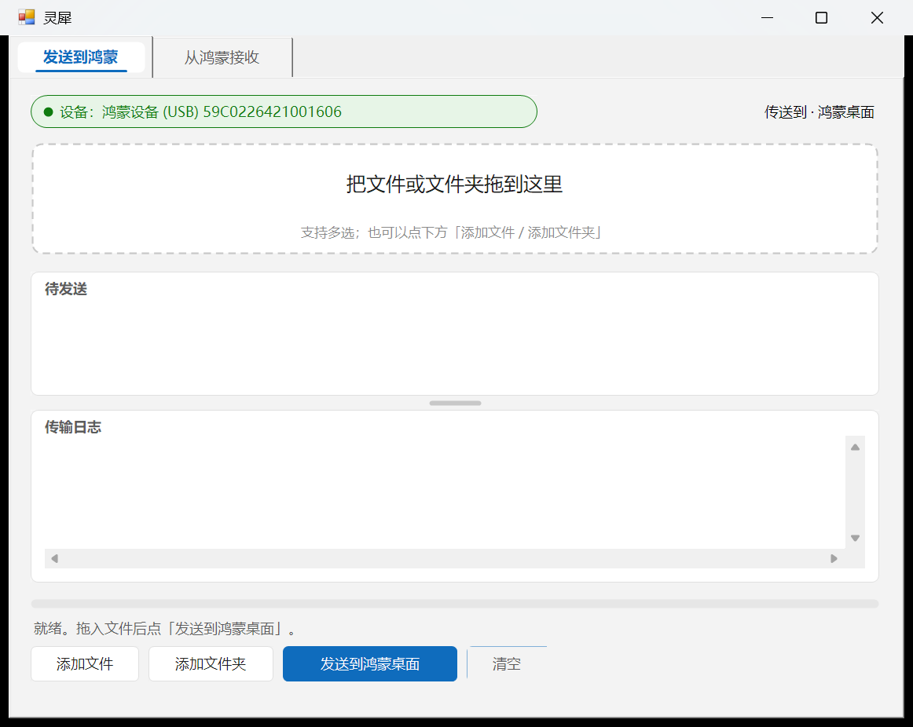

# 灵犀 / Lingxi

**Windows ↔ 鸿蒙电脑（HarmonyOS PC）双向传文件工具，走 hdc 数据线，不依赖局域网。**

插上数据线，把文件拖进窗口，就传过去了。反向也能浏览鸿蒙目录并拉回来。



> 主窗口「发送到鸿蒙」页；右侧「从鸿蒙接收」页可浏览设备目录并拉回文件。

---

## 为什么做这个

**一、鸿蒙在 HDC 调试模式下不暴露 MTP。**

把鸿蒙电脑用数据线接到 Windows 上，「此电脑」里不会出现设备图标 —— 因此既看不到手机/电脑里的文件，也不能拖拽复制。这是因为调试模式下的设备只提供 HDC 通道，不挂载媒体传输协议（MTP）。想要传一个文件，只能开 DevEco Studio 或者手敲 hdc 命令。

**二、局域网方案在受管理的网络里直接失效。**

LocalSend 这类工具要求收发双方在同一局域网且能互相直连。校园网和企业网的 AP 普遍开启**客户端隔离**（AP isolation / client isolation），同一 SSID 下的两台设备彼此不可见，服务发现广播收不到、TCP 连接也建不起来。这类方案不是慢，是彻底不通。

灵犀绕开这两点：它走 USB 数据线，用华为自带驱动的 HDC 协议传输，与网络环境无关。实测 **25–31 MB/s**，稳定。

---

## 功能

- **发送**：把文件或文件夹拖进窗口，传到鸿蒙的桌面目录。支持一次拖入多项、整个目录递归。
- **接收**：在第二个标签页里浏览鸿蒙的六个标准目录，勾选后拉取到本地，默认落在 `%USERPROFILE%\Desktop\from-harmony`。
- **命令行静默传输**：带参数运行时不弹窗，直接把结果打到 stdout，便于脚本和批处理调用。
- **实时进度**：进度条按**设备侧已落盘字节数**轮询，不是按本地已发送字节估算，进度不会提前跑满。
- **平均速率**：传输结束时显示本次的平均速度。
- **可拖动分栏**：列表与日志之间有分隔条，可以拖动调整高度。

界面是自绘的 Fluent 风格：圆角卡片、三态状态胶囊、自绘标签页、Primary/Secondary/Subtle 三种按钮，全部在 150% 等非整数缩放下按 DPI 缩放，文字不糊。

---

## 快速开始

> **不想自己编译？** 到 [Releases](https://github.com/HaJiMiManBoo111/lingxi/releases) 下载 `Lingxi-v0.1.0-win-x64.zip`（约 90 KB），解压即用，无需 .NET 安装。里面**不含 `hdc.exe`**，按下面第 1 步自备。

### 1. 准备 `hdc.exe`

程序本身**不打包 `hdc.exe`**（它属于华为 DevEco Studio，跟随其许可分发）。程序按以下顺序查找：

1. **程序同目录的 `hdc.exe`** —— 最省事，便携部署；
2. 环境变量 **`LINGXI_HDC`** 指向的路径；
3. **`PATH`** 里的 `hdc.exe`；
4. **DevEco Studio 默认安装路径**：
   `%ProgramFiles%\Huawei\DevEco Studio\sdk\default\openharmony\toolchains\hdc.exe`

任选其一即可。最简做法：从 DevEco Studio 安装目录里把 `hdc.exe` 复制到 `Lingxi.exe` 旁边。

### 2. 在鸿蒙侧打开 USB 调试

设置 → 关于本机 → 连点版本号进入开发者模式 → 开发者选项 → 打开「**USB 调试**」。插上线后，设备会弹授权对话框，**点允许**。

只插线不打开调试，`hdc list targets` 是看不到设备的 —— 这是最常见的问题。

### 3. 拖文件

运行 `Lingxi.exe`，把文件或文件夹拖进窗口，点「发送到鸿蒙桌面」。

---

## 命令行用法

不带参数运行 = 打开窗口。带参数 = 静默模式，不弹 GUI。

```
Lingxi.exe                                   打开窗口
Lingxi.exe <路径> [<路径>...]                静默发送到鸿蒙桌面
Lingxi.exe --list <远程目录>                 列出远程目录内容
Lingxi.exe --pull <远程路径...> [--to <本地目录>]
Lingxi.exe --log <文件>                      把整个过程追加写入该文件
```

示例：

```bat
:: 发送一个文件和一个文件夹
Lingxi.exe "D:\报告.docx" "D:\图片"

:: 列出鸿蒙桌面
Lingxi.exe --list /storage/media/100/local/files/Docs/Desktop

:: 把鸿蒙的一个目录和一个文件拉回本地
Lingxi.exe --pull /storage/media/100/local/files/Docs/Download/todo /storage/media/100/local/files/Docs/Desktop/note.txt --to "D:\收件箱"

:: 全程写日志，便于事后排查
Lingxi.exe --pull /storage/media/100/local/files/Docs/Desktop --to D:\bak --log D:\lingxi.log
```

stdout 的行格式（同时写进 `--log` 指定的文件）：

```
LIST|D|<名称>|<大小>
LIST|F|<名称>|<大小>
LIST|END|<条目数>
PULL|OK|<摘要>
PULL|FAIL|<原因>
```

退出码：成功 `0`，失败 `1`。

`--to` 缺省为 `%USERPROFILE%\Desktop\from-harmony`，目录不存在会自动逐级创建。

---

## 目录说明

```
.
├── build.cmd                 一键编译（自动定位 csc.exe）
├── Lingxi.exe                编译产物（不提交，见 .gitignore）
├── src/
│   ├── HdcCore.cs            核心逻辑：定位设备、发送、拉取、列目录、格式化
│   ├── Program.cs            入口：无参进 GUI，带参走静默模式
│   ├── MainForm.cs           全部界面：TabControl 两页，手算 SetBounds 布局
│   └── Fluent.cs             自绘控件库 + DPI 缩放层
├── res/
│   ├── app.ico               图标（9 档 16–256）
│   └── app.manifest          声明 dpiAware=true 与支持 Win8.1/10/11
├── tests/
│   ├── verify.ps1            发送方向验收（7 项）
│   ├── verify-recv.ps1       接收方向验收（8 项）
│   └── verify-gui2.ps1       拖拽接线与分栏拖动
├── docs/
│   ├── BUILD.md              从源码编译的完整步骤
│   ├── PITFALLS.md           踩坑手册（强烈建议先读）
│   └── ARCHITECTURE.md       内部接口契约与技术约束
└── .github/workflows/build.yml  CI：在 windows-latest 上编译
```

**技术栈**：C# 5 语法 + .NET Framework 4.0 WinForms。用系统自带的
`C:\Windows\Microsoft.NET\Framework64\v4.0.30319\csc.exe` 直接编译，
**不需要 Visual Studio，不需要 NuGet**。产物是单文件 `Lingxi.exe`，约 124 KB（实测 124,416 字节）。

---

## 从源码构建

双击 `build.cmd` 即可。它自动定位 `csc.exe` 并带上图标与清单资源。

手工编译（在 `src` 目录下执行）：

```bat
cd src
"C:\Windows\Microsoft.NET\Framework64\v4.0.30319\csc.exe" /nologo /target:winexe /out:../Lingxi.exe /win32icon:../res/app.ico /win32manifest:../res/app.manifest HdcCore.cs Program.cs MainForm.cs Fluent.cs
```

注意 `build.cmd` 里资源路径是 `%~dp0res\app.ico` —— 资源在 `res/` 子目录，不是根目录。

完整说明、依赖清单与常见编译错误见 [docs/BUILD.md](docs/BUILD.md)。

### 关于 CI

`.github/workflows/build.yml` 在 `windows-latest` 上真跑 `build.cmd`，并额外验两件事：产出的 `Lingxi.exe` 必须大于 100 KB（太小说明资源没嵌进去或编译没真正成功）、二进制里必须能搜到 `dpiAware`（说明 manifest 真的嵌进去了）。

它**不跑** `tests/*.ps1` —— 那三个脚本需要一台连着的鸿蒙真机，CI 里没有。

---

## 测试

三个 PowerShell 脚本，全部需要真机（鸿蒙设备已连线并授权调试）：

```bat
powershell -NoProfile -ExecutionPolicy Bypass -File tests\verify.ps1
powershell -NoProfile -ExecutionPolicy Bypass -File tests\verify-recv.ps1
powershell -NoProfile -ExecutionPolicy Bypass -File tests\verify-gui2.ps1
```

- `verify.ps1` —— 7 项：exe 存在、`hdc -v`、设备在线、静默传输、远程落盘核对、MessageBox 文案、清理。
- `verify-recv.ps1` —— 8 项：含中文名、目录递归拉取、覆盖写入、缺文件失败路径等。
- `verify-gui2.ps1` —— 拖拽接线与分栏拖动。

全部真机跑过：`PASS=7 FAIL=0`、`PASS=8 FAIL=0`。

> PowerShell 5.1 脚本**必须存为 UTF-8 带 BOM**，否则中文字面量会被按 GB2312 解码成乱码且不报错。细节见 [docs/PITFALLS.md](docs/PITFALLS.md)。

---

## 已知限制

- **必须打开 USB 调试。** 这是 hdc 能看见设备的前提，没有绕过的办法。
- **必须解锁屏幕才能看到注入效果。** 文件已经落到设备上了，但鸿蒙侧桌面/文件管理器的界面刷新在锁屏状态下不会即时反映，解锁后才会出现。这不是传输失败。
- **当前只支持 Windows 侧。** 鸿蒙侧的发送/接收界面不在本项目范围内，本项目只做 Windows 这一端。
- **依赖 hdc 的可用性。** 程序不内嵌 hdc，找不到就只会提示「缺少 hdc.exe」，不会自己下载。
- **目录传输会再套一层同名目录。** 这是 hdc 自身的行为（`file send <目录> <父目录>` 会在父目录下新建同名目录），见踩坑手册。

---

## 与同类项目对比

- **ECHO** 是一个 HDC 的图形界面外壳，用来跑 hdc 命令，**本身不带文件传输功能**。
- **LocalSend** 不支持鸿蒙电脑，且依赖局域网直连 —— 在开启 AP 客户端隔离的校园网/企业网里直接失效。

灵犀只做一件事：在 Windows 和鸿蒙电脑之间可靠地双向传文件，用的还是那根数据线。

---

## 许可

[MIT](LICENSE) © 2026 Lingxi contributors

---

## English summary

**Lingxi** is a two-way file transfer tool for Windows ↔ HarmonyOS PC over a USB cable, built on Huawei's `hdc` protocol. It requires no local network.

It exists because HarmonyOS devices in HDC debug mode do not expose MTP — they never appear under "This PC" in Windows Explorer, so drag-and-drop is impossible. LAN-based tools such as LocalSend are equally unusable on campus or corporate networks where AP client isolation prevents peer-to-peer connections. Lingxi sidesteps both problems by transferring over USB, measured at a stable 25–31 MB/s.

Written in C# 5 against .NET Framework 4.0 WinForms and compiled with the `csc.exe` that ships with Windows — no Visual Studio, no NuGet, a single 124,416-byte `Lingxi.exe`.

Features: drag-and-drop file and folder upload to the HarmonyOS desktop, remote directory browsing and pull, a scriptable silent command-line mode (`--list`, `--pull`, `--log`), progress reported from bytes actually committed on the device, and average transfer speed on completion.

`hdc.exe` is **not** bundled. Lingxi looks for it in the application folder, then `LINGXI_HDC`, then `PATH`, then the default DevEco Studio install location. USB debugging must be enabled and authorized on the HarmonyOS device; the screen must be unlocked for injected files to appear.

Build by running `build.cmd`, or see [docs/BUILD.md](docs/BUILD.md). Before contributing, read [docs/PITFALLS.md](docs/PITFALLS.md) — it documents several silent-failure modes, including a directory integrity-level issue that makes `hdc` return an empty device list with exit code 0.

Licensed under the MIT License.
